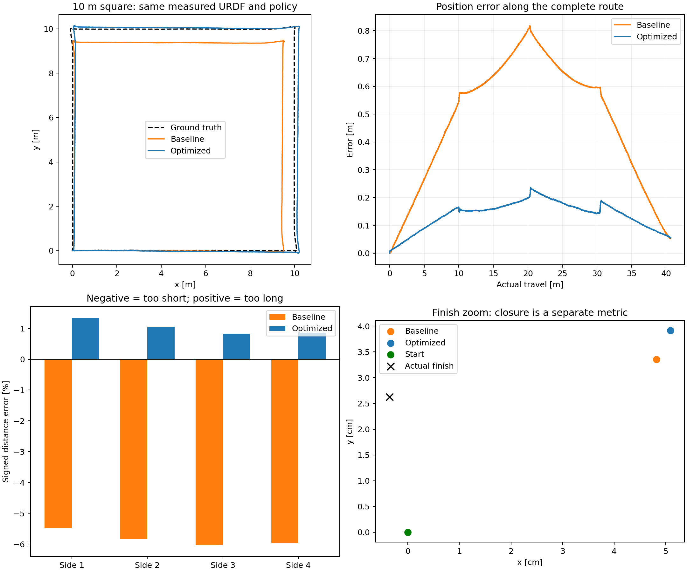

# Marsdog 新 URDF 优化前后对比

日期：2026-11-09（Asia/Shanghai）。

机械模型来自 `/home/sunbird/marsdog_v17_source/quadruped.urdf`；策略、PD 参数和运行器使用原 SDK。两次测试的全部 IMU/14 轴输入文件 SHA-256 完全相同，真实轨迹逐帧一致。

连续完成 10×10 米方形，实际累计行程 40.641 米，共 98,090 帧。只做起始位姿对齐，没有尺度拟合；位置真值只用于路线控制和评分，接触真值未输入估计器。

| 指标 | 同模型基线 | 优化后 |
|---|---:|---:|
| 全程位置 RMSE | 0.53814 m | 0.15033 m |
| 最大位置误差 | 0.81736 m | 0.23672 m |
| 终点估计与真实终点差 | 0.05231 m | 0.05601 m |
| 水平速度 RMSE | 0.06307 m/s | 0.01286 m/s |
| 相对航向 RMSE | 0.01375 ° | 0.00085 ° |
| 高度 RMSE | 0.00945 m | 0.00949 m |

| 边 | 实际距离 | 基线估计 | 优化估计 | 优化距离误差 |
|---|---:|---:|---:|---:|
| 1 | 9.987 m | 9.439 m | 10.122 m | +1.349% |
| 2 | 9.986 m | 9.403 m | 10.092 m | +1.061% |
| 3 | 9.987 m | 9.384 m | 10.069 m | +0.820% |
| 4 | 9.973 m | 9.378 m | 10.060 m | +0.866% |

优化包括：机身角速度补偿、球形脚掌滚动位置补偿、按载荷和速度一致性加权支撑脚观测，以及按实际时间戳预测（修正 5 ms 固定步长与 2 ms 输入不一致）。未乘经验距离比例。

本次全程位置 RMSE 降低 72.06%，闭环终点差未减小。相反方向误差可在回程抵消，因此不能单看闭环。当前仍是平地、理想传感器仿真，残余足底滑动、力矩动力学补偿和真机标定仍待处理。



[PDF](comparison.pdf) · [数值](comparison.json)

复现：

```bash
scripts/run_marsdog_sim.sh --scenario square --side-length 10 --estimator-profile baseline
scripts/run_marsdog_sim.sh --scenario square --side-length 10 --estimator-profile optimized
```
